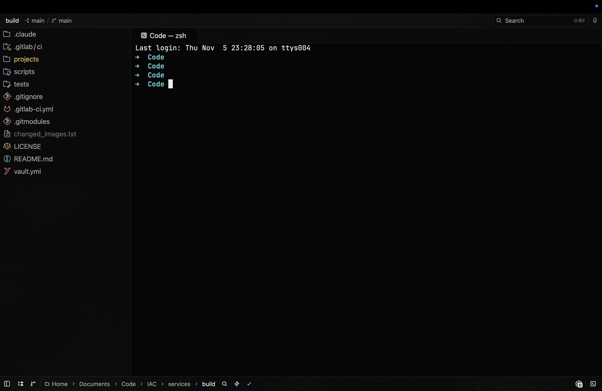

# zed (terax branch)

[Zed](https://github.com/zed-industries/zed) `v1.26.2` with a few patches that make it work like
[Terax](https://terax.app), a terminal-first editor: the file tree follows the terminal, a clickable
path, agent notifications and a background picture.



_The patched Zed with the Terax Glass theme. Zed's own README is in [`terax/UPSTREAM_README.md`](terax/UPSTREAM_README.md)._

| Patch | Where | Code |
|---|---|---|
| File tree follows `cd` | terminal | `crates/terminal_view/src/terminal_view.rs` (`follow_terminal_cwd`) |
| Clickable path | status bar | `crates/terminal_view/src/cwd_breadcrumb.rs` |
| Search field, notification bell | title bar | `crates/title_bar/src/title_bar.rs`, `crates/terminal_view/src/bell_center.rs` |
| Agent notifications (OSC 777 / OSC 9) | terminal | `vendor/vte`, `vendor/alacritty_terminal`, `crates/terminal/src/terminal.rs` |
| Background picture | whole window, Settings | `crates/workspace/src/background_image.rs`, `crates/settings_ui/src/page_data.rs` |
| Rendered / Raw switch | Markdown | `crates/zed/src/zed/markdown_mode_toggle.rs` |
| No "Partial file index" message | status bar | `crates/activity_indicator/src/activity_indicator.rs` |
| Builds with Command Line Tools | build | `crates/gpui_apple/Cargo.toml` |

## Terminal and file tree

- **Tree follows the terminal.** `cd` in a focused terminal and that folder becomes the only folder
  in the file tree. Not on the folder a terminal starts in, not for `/`, not in remote projects.
- **Clickable path** at the bottom left: `Home › Documents › … › project`. A click switches the tree
  and types `cd` into the terminal, like Terax. Skipped while a program other than the shell runs in
  front (vim, ssh, claude).
- **No "Partial file index" message.** Outside a git repo Zed scans `file_scan_depth` levels
  (default 5) and loads deeper folders when you open them. Upstream says so in the status bar each
  time, which with a tree that follows `cd` meant on almost every `cd`. Like Terax, which reads each
  folder only when it is opened, this build stays quiet. Search and the file finder still skip
  folders deeper than that until they are opened; raise `file_scan_depth` if you need them.
- **Prompt.** The terminal shows your own shell prompt (for example oh-my-zsh
  `➜  repo git:(main) ✗`). Terax hides it in block mode and draws its own input bar; Zed has no
  block mode, so nothing is replaced.
- Each new folder goes through Zed's trust check. Trust a parent once, for example `~/Documents/Code`,
  and everything below it is trusted.

## Notifications

- **Bell** in the title bar with a count. It lists terminals that want attention while you look
  elsewhere: `edge-ciq · needs your input`, `edge-ciq · finished`. A click jumps to that terminal,
  looking at a terminal clears its entry.
- **Native Terax notifications.** The terminal understands OSC 777 (`777;notify;title;body`) and
  OSC 9. Terax's Claude Code hooks send `working`, `attention` and `finished`; set
  `"terminal": { "env": { "TERAX_TERMINAL": "1" } }` and they work in Zed unchanged.
- **Sound:** `Ping` when an agent needs you, `Glass` when it is done. **Banner:** a macOS
  notification when Zed is not in front.
- A plain terminal bell (`\a`) shows up too, without sound.

## Background picture

Settings → Appearance → **Background Image**, or in `settings.json`:

```jsonc
"background_image": {
  "path": "~/Pictures/wallpaper.png",
  "opacity": 1.0,        // picture, 0 to 1
  "blur": 0,             // pixels, applied once and cached
  "panel_opacity": 0.55  // editor, terminal and panels, 0 (see-through) to 1 (solid)
}
```

Commands: `workspace: select background image`, `workspace: clear background image`. Menus and
popovers stay solid.

## Markdown

`.md` files get a **Rendered | Raw** switch at the top right. Raw swaps the preview for the editor in
the same place. With `"markdown_preview": { "open_markdown_files_in_preview": true }` a click in the
tree opens them rendered.

## Download

[Releases](https://github.com/j551n-ncloud/zed/releases): `Zed-<version>-terax.<n>-arm64.zip` for
Apple Silicon. It is signed ad hoc, not notarized, so after unzipping run once:

```sh
xattr -dr com.apple.quarantine Zed.app && mv Zed.app /Applications/
```

Releases are built by [`.github/workflows/terax.yml`](.github/workflows/terax.yml) on a GitHub
macOS runner: push a tag like `v1.26.2-terax.3`, or start the workflow by hand for a test build.
Zed's own workflows are removed on this branch.

| Release | Changes |
|---|---|
| `v1.26.2-terax.2` | No "Partial file index" message, release workflow |
| `v1.26.2-terax.1` | First release: tree follows `cd`, clickable path, bell and OSC 777 notifications, background picture, Markdown switch |

## Build (macOS)

```sh
curl --proto '=https' --tlsv1.2 -sSf https://sh.rustup.rs | sh -s -- -y
brew install cmake

git clone -b terax https://github.com/j551n-ncloud/zed.git
cd zed
CARGO_PROFILE_RELEASE_FAST_DEBUG=0 cargo build --profile release-fast -p zed -p cli
terax/bundle.sh   # -> target/release-fast/bundle/Zed.app and a zip
```

The first build takes about 30 minutes on an M2 and needs around 10 GB in `target/`. Name it
`target.noindex` (with a `target` link to it) so Spotlight does not index the build. Metal shaders
compile at runtime, so the Command Line Tools are enough; no full Xcode.

## License

Same as upstream Zed: see the `LICENSE-*` files. `vendor/vte` and `vendor/alacritty_terminal` keep
their own licenses (MIT / Apache-2.0).
